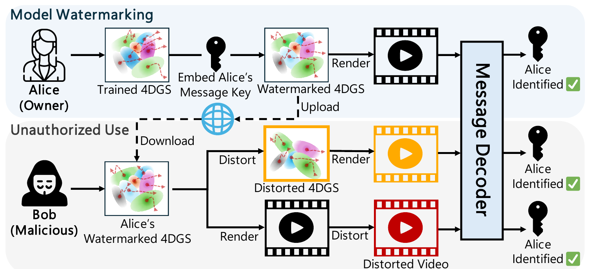
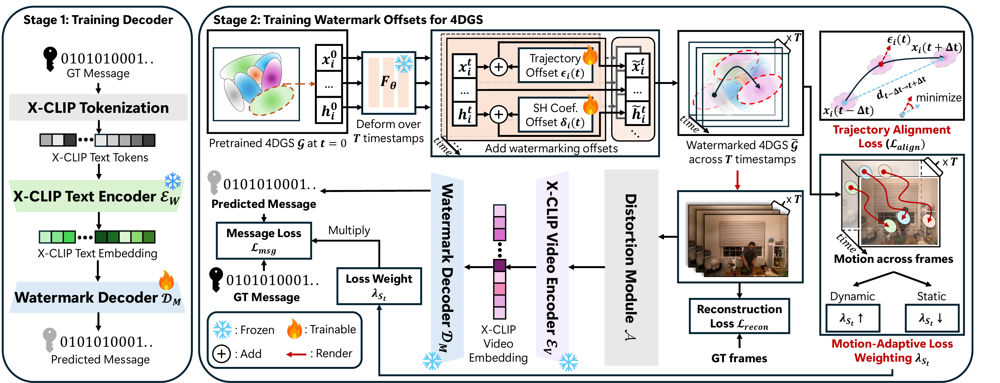

<div align="center">

# Mark4D

### Temporally-Consistent Watermarking for 4D Gaussian Splatting

Jaejin Lee\* · Minjae Jeong\* · Joonhyuk Park · Yechan Hwang · Seunghun Baek · Won Hwa Kim

Pohang University of Science and Technology (POSTECH)

<sub>\* Equal contribution</sub>

**CVPR 2026**

<a href="https://openaccess.thecvf.com/content/CVPR2026/html/Lee_Mark4D_Temporally-Consistent_Watermarking_for_4D_Gaussian_Splatting_CVPR_2026_paper.html"></a>
<a href="https://openaccess.thecvf.com/content/CVPR2026/supplemental/Lee_Mark4D_Temporally-Consistent_Watermarking_CVPR_2026_supplemental.zip"></a>
<a href="#citation"></a>
<a href="#license"></a>

</div>

---

<p align="center">
  
  <br>
  <em>An owner embeds a message key into a trained 4DGS model and releases it. Even if the model or its rendered videos are distorted, the embedded message is recovered.</em>
</p>

---

## TL;DR

**Mark4D** embeds an invisible, temporally consistent binary message into a pretrained
[4D Gaussian Splatting](https://github.com/hustvl/4DGaussians) (4DGS) model. The message is
recovered from rendered videos and frames, even after image, video and model-level distortions.

- **Decoding in a video–text latent space.** Messages are decoded from the latent space of a frozen X-CLIP model, not from pixels. This keeps decoding stable under pixel-level distortions.
- **Offsets that follow motion.** Watermark offsets are added to the deformed Gaussians and aligned with each Gaussian's motion trajectory, which preserves geometry.
- **Motion-aware supervision.** The message loss is weighted by the motion magnitude of each temporal window, which balances static and dynamic segments.

## Method

<p align="center">
  
</p>

Mark4D has two stages:

1. **Stage 1: X-CLIP guided decoder.** Each L-bit message is mapped to X-CLIP text tokens by a fixed bit-to-token table. A message decoder D<sub>M</sub> learns to recover the bits from the frozen X-CLIP text embedding (Sec. 4.2).
2. **Stage 2: watermark offsets for 4DGS.** The pretrained 4DGS and its deformation network stay frozen.
   - **Offsets.** Time-dependent offsets ε<sub>i</sub>(t) on positions and δ<sub>i</sub>(t) on SH coefficients are added at every timestamp. Both are Fourier series over time.
   - **Decoding.** Rendered clips pass through a distortion module and the frozen X-CLIP video encoder, then D<sub>M</sub> decodes them.
   - **Losses.** A trajectory alignment loss keeps ε<sub>i</sub>(t) along each Gaussian's motion (Sec. 4.3). A motion-adaptive weight λ<sub>S<sub>t</sub></sub> scales the message loss per window (Sec. 4.4).

## Code

This repository contains the full training and evaluation code of Mark4D. It is built on top of the
official [4DGaussians](https://github.com/hustvl/4DGaussians) code base.

- **What is not released:** pretrained 4DGS models, decoders, watermark offsets and datasets. All of them can be produced with the scripts below.
- **Hyperparameters:** no training hyperparameters are preset. Pass them on the command line ([Hyperparameters](#hyperparameters)).

## Repository structure

```
mark4d/
  decoder.py       X-CLIP tokenization (Eq. 8, Supp. Alg. 1) and message decoder D_M (Eqs. 9-11)
  offsets.py       Fourier-series offsets eps_i(t) on positions and delta_i(t) on SH coefficients (Eqs. 6, 15)
  motion.py        trajectory alignment loss (Eqs. 13-14), motion-adaptive weights (Eqs. 16-18)
  distortions.py   differentiable distortion module A with straight-through estimator (Sec. 4.5, Supp. A.2)
  cameras.py       fixed-viewpoint camera sequences used for training / evaluation (Sec. 5.1)
  evaluation.py    bit accuracy (video / frame level), PSNR / SSIM / LPIPS, robustness
train_decoder.py   Stage 1: train the X-CLIP guided decoder
train_watermark.py Stage 2: embed a message into a pretrained 4DGS
eval_watermark.py  evaluation of a watermarked 4DGS
train.py, render.py, arguments/, scene/, gaussian_renderer/ ...   4DGaussians (pretraining)
```

The only change to the 4DGaussians code is in `gaussian_renderer/__init__.py`. `render()` takes
optional `xyz_offset` and `sh_offset` arguments, which are added to the deformed Gaussians at the
camera time (Eq. 6).

## Installation

```bash
git clone --recursive <this repository> Mark4D
cd Mark4D
conda create -n mark4d python=3.10 -y
conda activate mark4d

# PyTorch with CUDA (choose the build matching your driver), e.g.
pip install torch==2.1.2 torchvision==0.16.2 --index-url https://download.pytorch.org/whl/cu118

pip install -r requirements.txt
pip install -e submodules/depth-diff-gaussian-rasterization
pip install -e submodules/simple-knn
```

If you cloned without `--recursive`, run `git submodule update --init --recursive` first.
H.264 distortion uses PyAV with `libx264`. The `av` wheels on PyPI include it.

## Data preparation

We follow the data preparation of 4DGaussians.

**D-NeRF.** Download the synthetic scenes from [D-NeRF](https://github.com/albertpumarola/D-NeRF)
([dropbox](https://www.dropbox.com/s/0bf6fl0ye2vz3vr/data.zip?dl=0)) and place them under
`data/dnerf/<scene>` (`bouncingballs, hellwarrior, hook, jumpingjacks, lego, mutant, standup, trex`).

**DyNeRF.** Download the six scenes of the [Plenoptic Video dataset](https://github.com/facebookresearch/Neural_3D_Video)
(`coffee_martini, cook_spinach, cut_roasted_beef, flame_salmon_1, flame_steak, sear_steak`) to
`data/dynerf/<scene>`. Then, for each scene:

```bash
# 1. extract frames from the videos
python scripts/preprocess_dynerf.py --datadir data/dynerf/<scene>
# 2. COLMAP poses and dense point cloud (writes data/dynerf/<scene>/colmap/sparse/0, used by Mark4D cameras)
bash colmap.sh data/dynerf/<scene> llff
# 3. downsample the point cloud
python scripts/downsample_point.py data/dynerf/<scene>/colmap/dense/workspace/fused.ply data/dynerf/<scene>/points3D_downsample2.ply
```

**Watermarking views (Sec. 5.1).** You do not need to preprocess anything else.

- Mark4D renders its own temporally continuous videos from the pretrained 4DGS model. For every scene, 21 fixed viewpoints are placed around the scene, and each renders 300 consecutive frames (time t ∈ [0, 1]).
- D-NeRF viewpoints lie on a circle around the object. DyNeRF viewpoints lie on a spiral around the average camera pose.
- 20 viewpoints are used for training and one held-out viewpoint for evaluation (`mark4d/cameras.py`).

## Step 1. Pretrain 4DGS

Train 4DGS with the official configuration: 20,000 iterations for D-NeRF and 14,000 for DyNeRF.

```bash
python train.py -s data/dnerf/mutant --port 6017 --expname dnerf/mutant --configs arguments/dnerf/mutant.py
python train.py -s data/dynerf/flame_salmon_1 --port 6017 --expname dynerf/flame_salmon_1 --configs arguments/dynerf/flame_salmon_1.py
```

## Step 2. Train the X-CLIP guided decoder

The decoder only depends on the message length L. It is trained once and shared by all scenes.

```bash
python train_decoder.py --msg_len 48 --out_dir checkpoints/decoder \
    --num_epochs <E> --batch_size <B> --lr <LR>
```

The script trains on 5,000 random messages with an 80:20 train/test split (Supp. B). The
bit-to-token mapping Φ is fixed by `--seed` and stored in the checkpoint.

## Step 3. Embed a watermark

```bash
# D-NeRF
python train_watermark.py --dataset dnerf \
    --model_path output/dnerf/mutant --configs arguments/dnerf/mutant.py --iteration 20000 \
    --decoder checkpoints/decoder/decoder_48bit.pth --out_dir output/mark4d/mutant_48bit \
    --num_iterations <N> --num_freqs <K> --lr_fourier <LR> --lr_sh <LR> \
    --lambda_recon <W> --lambda_align <W> --lambda_min <W> --lambda_max <W> --max_combine <M>

# DyNeRF
python train_watermark.py --dataset dynerf \
    --model_path output/dynerf/flame_salmon_1 --configs arguments/dynerf/flame_salmon_1.py --iteration 14000 \
    --decoder checkpoints/decoder/decoder_48bit.pth --out_dir output/mark4d/flame_salmon_48bit \
    --num_iterations <N> --num_freqs <K> --lr_fourier <LR> --lr_sh <LR> \
    --lambda_recon <W> --lambda_align <W> --lambda_min <W> --lambda_max <W> --max_combine <M>
```

- **Message.** By default, a held-out test message of the decoder is embedded. Pass `--message 0101...` to embed your own L-bit message.
- **Output.** The learned offsets are written to `<out_dir>/offsets.pth`. The pretrained 4DGS itself is not modified.

## Step 4. Evaluate

```bash
python eval_watermark.py --offsets output/mark4d/mutant_48bit/offsets.pth \
    --decoder checkpoints/decoder/decoder_48bit.pth --distortions all --model_level --save_frames
```

The script reports the following, and writes them to `eval_results.json`:

- **Video-level bit accuracy:** non-overlapping T=8 frame clips of the test view.
- **Frame-level bit accuracy:** each frame repeated into a static clip.
- **Image quality:** PSNR / SSIM / LPIPS against the original 4DGS rendering.
- **Robustness:** bit accuracy under each distortion of Tab. 2, applied with the real, non-differentiable operations.

## Hyperparameters

No training hyperparameters are preset. Pass all of them on the command line.

| argument | meaning | paper |
|---|---|---|
| `--msg_len` | message length L | Sec. 5.1 |
| `--num_epochs`, `--batch_size`, `--lr` | decoder D_M training (`train_decoder.py`) | Supp. B |
| `--num_iterations` | watermark optimization steps | Sec. 5.1 |
| `--num_freqs` | Fourier components K of eps_i(t) and delta_i(t) | Eq. 15 |
| `--lr_fourier`, `--lr_sh` | learning rates of eps_i(t) and delta_i(t) | Sec. 5.1 |
| `--lambda_recon`, `--lambda_align` | loss weights | Eq. 21 |
| `--lambda_min`, `--lambda_max` | range of the motion-adaptive weight | Eq. 18 |
| `--max_combine` | max number of distortions combined per training clip (0 disables the distortion module) | Sec. 4.5 |

Fixed components: X-CLIP `microsoft/xclip-base-patch32` (ViT-B/32, 512-d), decoder D_M = 3-layer MLP (512-512-256-L), clip length T = 8.

Training distortions (`--distortions`, default: all):

| | distortions |
|---|---|
| Frame-level | Gaussian noise (σ=0.1), rotation (±30°), scaling ([0.75, 1.25]), Gaussian blur (k=3, σ=0.1), crop (40%), brightness ([0.5, 1.5]), JPEG (quality 50) |
| Video-level | H.264 (CRF 30), random frame swap (25%) |

During training, up to `--max_combine` randomly chosen distortions from `--distortions` are applied to each clip.
JPEG, H.264 and frame swap use a straight-through estimator.

## Citation

If Mark4D is useful in your research, please cite:

```bibtex
@inproceedings{lee2026mark4d,
  title     = {Mark4D: Temporally-Consistent Watermarking for 4D Gaussian Splatting},
  author    = {Lee, Jaejin and Jeong, Minjae and Park, Joonhyuk and Hwang, Yechan and Baek, Seunghun and Kim, Won Hwa},
  booktitle = {Proceedings of the IEEE/CVF Conference on Computer Vision and Pattern Recognition (CVPR)},
  pages     = {39393--39402},
  year      = {2026}
}
```

## Acknowledgements

This code is built on [4DGaussians](https://github.com/hustvl/4DGaussians) and
[3D Gaussian Splatting](https://github.com/graphdeco-inria/gaussian-splatting).

- The camera trajectories follow [GuardSplat](https://narcissusex.github.io/GuardSplat/) and [CopyRNeRF](https://github.com/luo-ziyuan/CopyRNeRF-code).
- The decoder uses [X-CLIP](https://huggingface.co/microsoft/xclip-base-patch32) from Hugging Face Transformers.

## License

- **This repository:** distributed under the terms in [LICENSE.md](LICENSE.md), the Apache 2.0 license of 4DGaussians.
- **Third-party components:** the Gaussian rasterizer and the renderer derived from 3D Gaussian Splatting are for non-commercial research and evaluation use only. See [LICENSE_THIRD_PARTY.md](LICENSE_THIRD_PARTY.md).
